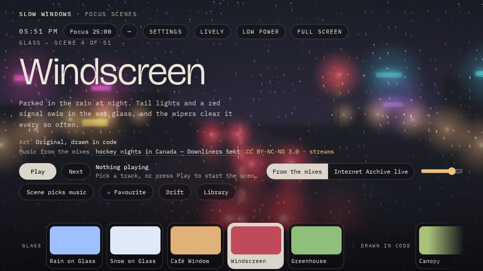
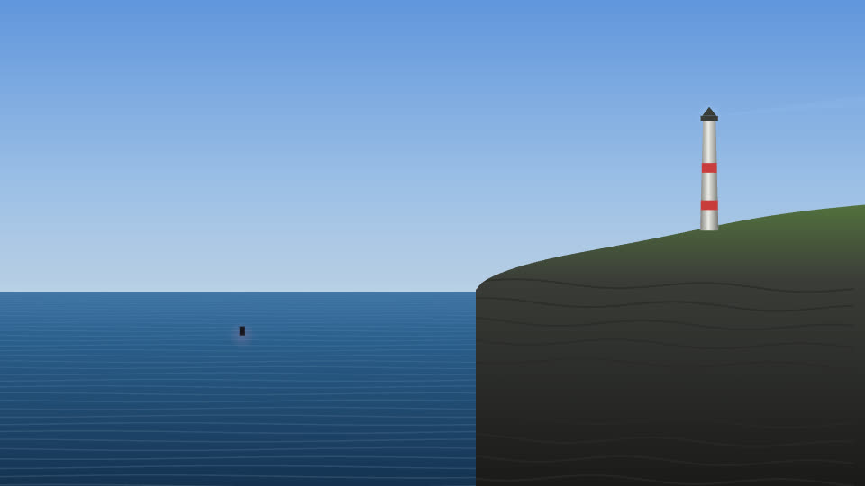
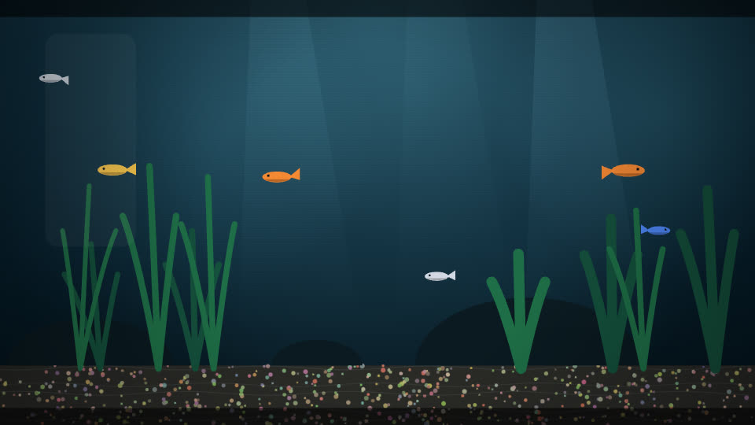
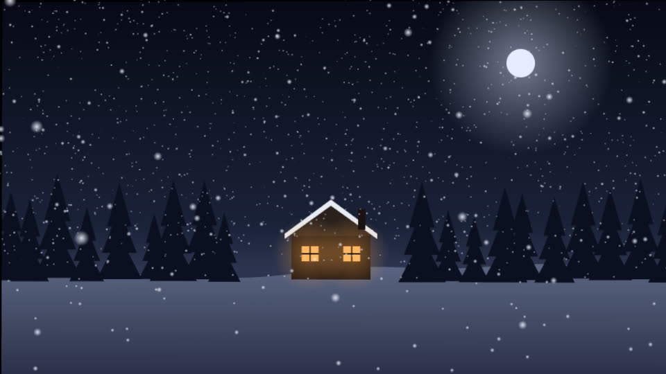
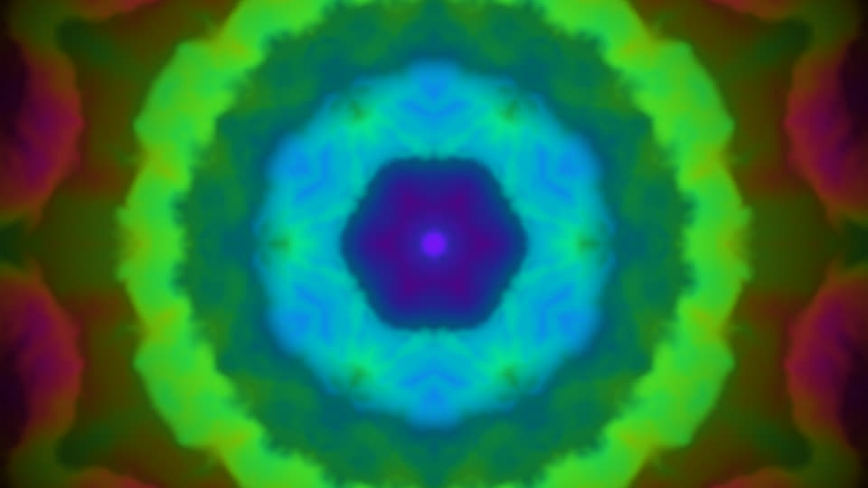

# Slow Windows

**Open it: https://danieljcroberts.github.io/focusMusic/** (installs to a phone's home screen; works offline after the first visit)

|  |  |  |
|---|---|---|
|  |  |  |

Ambient scenes to work beside: rain on a window, a pixel-art forest, an ocean at dusk. Each scene is paired with a Creative Commons track from the [Music For Programming](https://musicforprogramming.net) mixes, and there is a focus timer that dims the scene for breaks.

Everything in it is either drawn in code or licensed for reuse. `CREDITS.md` lists every asset, its author and its licence.

**Slow Windows is free and will stay free.** Most of the music is Creative Commons non-commercial (BY-NC, BY-NC-SA, BY-NC-ND), which rules out selling the app, charging for access, or running ads. Any contribution has to fit that: no NC-incompatible monetisation, ever.

## Run it

```sh
npm install
npm run fetch-music   # downloads the archive.org bundled tracks (not in git); the Bandcamp ones are listed as missing and need a manual download
npm run dev           # http://localhost:5173
```

`npm run build` writes a static site to `dist/`. Open it from any web server; the page uses relative paths.

Lighthouse, Above the Clouds, Pond, Low Tide and Aurora follow your clock: daylight from about 06:00, dusk around 18:00 to 19:30, night after. There is no location lookup, so the times are fixed.

Each scene has an ambient sound layer (rain, wind, sea, fire, a café, a train, a storm, bubbles, a low hum) generated in Web Audio from filtered noise, with nothing to download. The **Ambience** slider sets its level; it follows the weather where that makes sense and starts after your first click or key, as browsers require.

The Trip group is eight full-screen shaders that move with the music (bass, mid and treble from the analyser; a gentle pulse when the player can't be analysed). They are slow and never flash. **Lively** (top bar, or V) speeds them up and lets the music push harder.

## Publish it

```sh
scripts/deploy-pages.sh   # lint, check, build, then push dist/ to the gh-pages branch
```

GitHub Pages serves that branch once it is chosen in the repository's Settings → Pages (Deploy from a branch, `gh-pages`, root). `scripts/github-pages.workflow.yml` is an equivalent GitHub Actions workflow for when a credential with the `workflow` scope is at hand.

## Android app

The same code builds an Android app with [Capacitor](https://capacitorjs.com). It needs Java 21 and the Android SDK (platform 36); set `JAVA_HOME` and `ANDROID_HOME`, or put `sdk.dir=…` in `android/local.properties`.

```sh
npm run apk     # builds the web app in native mode into dist-native/, copies it into android/, then a debug APK
                # → android/app/build/outputs/apk/debug/app-debug.apk
```

What the app adds over the web app is in `src/native.js`, `src/native-ui.js` and `android/app/src/main/java/…/`: music keeps playing with the screen off, with the track and its controls on the notification, the lock screen and headphone buttons (a media session in a foreground service); the bundled music can be downloaded into the app; the sunrise alarm is a real alarm clock that opens the app over the lock screen; Quick Settings tiles start a focus block or Bedtime; a scene can be set as the wallpaper (refreshed each morning if wanted); a home-screen widget shows today's focus minutes and the streak with a Start button; picture-in-picture keeps the scene playing in a small window when the app is left; pictures of scenes save to the phone's photos; and timer notifications use Android's own. The bundled music is left out of the app to stay under Google Play's 200 MB limit and streams from the live site instead; the scenes are inside the app. Every web change reaches the app on its next build. To release both at once:

```sh
npm run release -- "What changed, in a line"
```

That raises the Android version, builds the web app and the APK, commits and pushes the version change, and publishes both to GitHub Pages, the APK beside an `app-version.json` that the installed app checks: phones with the app then offer the update, with that line as its note. A plain `scripts/deploy-pages.sh` keeps the published APK in place.

For Google Play, `npm run bundle` builds a signed bundle with the upload key in `~/.android-keys/` (keep that folder backed up and out of git). The listing text, permission declarations and pictures are in `docs/play-store/`; `node scripts/store-art.mjs` regenerates the pictures.

## Add music

```sh
node scripts/find-music.mjs ambient piano     # Creative Commons tracks on archive.org, printed as tracks.json entries
```

Confirm each licence on the item page, then paste the entries into `src/data/tracks.json`. Tracks with a `file` name are bundled by `npm run fetch-music`; the rest stream.

## Check it

`npm run unit` runs the fast tests of the app's logic (moon, seasons, weather, aurora, shuffle, look-back, updates) in a second; `npm test` runs them with lint, the data check, a build and the smoke test.

```sh
npm run check   # scene and track data agree with each other and with the files on disk
npm run smoke   # opens the built site in headless Chromium and steps through every scene
npm test        # both, with a build in between
```

## Layout

```
index.html            page markup
src/main.js           boot, scene switching, timer, keys, swipe, idle and wake lock
src/music.js          players, crossfades, the library and the Internet Archive live source
src/data/scenes.js    scene metadata: names, descriptions, art credits, paired tracks
src/data/tracks.json  the Creative Commons tracks with licence, episodes and source
src/scenes/           the renderers: shaded.js, shaded2.js, power.js, power2.js, places.js, glass.js, interiors.js, outdoors.js, power.js, parallax.js,
                      cozy.js, cosmos.js, three-scenes.js, trip.js, abstract.js, video.js
public/assets/scenes  scene art (in git)
public/assets/thumbs  a 160×90 thumbnail per scene, shown until the scene has been seen (in git)
public/assets/music   bundled tracks (fetched, not in git)
scripts/              check, fetch-music, smoke, thumbs (captures the shipped scene thumbnails from a running dev server)
```

**Start with** (on the first visit and at the top of the sheet) offers three moods, Study, Relax and Sleep, each setting the soundtrack, scene, ambience and timer in one tap. Scene code loads the first time a scene opens and the rest is fetched quietly in the background, so the app starts quickly. Every scene has a link: the address bar follows the scene (`#aurora-from-orbit`), and **Share this scene** (under App in the sheet) copies it or opens the phone's share sheet. The controls are one bar: Play, Next, the soundtrack chip, the scene's name (which opens the scene's story, credits and the grid of every scene) and **⋯**, which opens the sheet with everything else in five sections, each headed by a line that says what it is doing now: Now playing, Music, Timer, Scene and App.

A scene that throws on a device is shown as a card with the error in the diagnostics overlay; the rest of the app carries on. The focus timer takes a long break after every fourth block and has custom durations in its menu.

Keyboard: ← → scenes · Space play/pause · N / P next / previous track · ↑ ↓ volume · M scenes change the track · O the sheet · S favourite · D drift · V lively · T timer · L library · F full screen.

Star scenes with **Favourite**; **Drift** then moves between them (or all scenes, if none are starred) every 10, 20 or 30 minutes, preferring scenes that suit the hour, with the next track starting a few seconds ahead of the switch. Tracks crossfade into each other rather than stopping. Reopening the app carries on where you left off, the same track at the same place: the installed app is allowed to start playing by itself, and in a browser the first tap anywhere does it. The **soundtrack** chip next to Next picks a genre: **Ambient**, **Downtempo Electronic**, **French language**, **High energy**, **Jazz**, **Lo-fi**, **Minimalist**, **Misc**, **Modern Classical**, **Post-rock** and **Synthwave & Techno** are built in, each with an icon, and the free tracks are sorted into them (Jazz, French language and High energy are for your own music); you can add soundtracks of your own. **Add your music…** (in the chip's menu, under Music in the sheet, or in the track list) opens a short guide: say whether your music is in a folder per type or all in one place, choose the folder, check where each folder goes (folders named for a genre, such as *Jazz*, *Lo-fi* or *Chanson*, join the matching soundtrack; others become new soundtracks), then choose whether to mix the free tracks in or play only your music. Loose tracks are sorted by their genre tag or a quick measurement of how lively they sound, and the guide asks about any it is unsure of, with a Listen button. Your files are copied into the app's private storage on that device and never leave it. **Edit soundtracks** renames them, turns their free tracks and random Internet Archive finds on or off, removes tracks and deletes your own soundtracks; *Re-sort recent tracks* walks through your latest additions one at a time, and on browsers with the File System Access API *Check for new music* re-reads the folder you chose and adds what is new. **Music follows** (under Music in the sheet) is one choice: Nothing, The scene (each scene suggests a built-in soundtrack from its mood: calm scenes Ambient, warm ones Lo-fi, lively ones Downtempo Electronic or Synthwave & Techno; a soundtrack of your own stays put), The timer (Ambient for focus blocks, Downtempo Electronic for breaks) or Both. **Scenes change the track**, off by default, decides whether a new scene also crossfades to a track that suits it (also `M`); off, a new scene keeps the music going. Next, gapless changes and Drift draw from the current soundtrack, and nothing comes round again until everything else in it has played once. **♥ Love** (in the mini player, under Now playing, or `H`) adds the playing track to the **Loved** soundtrack, and loved tracks come up a little more often everywhere; tracks you skip within ten seconds a few times come up less, and tracks you let play a little more. Each track's loudness is measured the first time it plays and levelled after that, so quiet and loud tracks sit together. **Play next** on any track in the track list queues it, shown under Now playing. **Never play** on a free track in the track list leaves it out of every soundtrack. Your own tracks join tightly, as an album's do. **Keep streams I've heard** (under Music) keeps streamed tracks you stay with on the device, up to 300 MB, oldest out first, so they play offline; **Re-read tags** under Edit soundtracks reads covers, genre and length again for tracks added earlier. Each scene names a preferred track and a tone; when the preferred track was heard recently, another of the same mood plays instead. The sheet's other sections hold the weather and time-of-day overrides, the drift interval, a sleep timer (the scene dims and the music and ambience fade over the last two minutes, then it stays dark; or End of track, which lets the playing track finish), **Use my location** (Open-Meteo: rain outside means rain on the glass, and sunrise and sunset follow your sky; coordinates are rounded and stay in your browser), this week's focus blocks, "Save music for offline use", a **Film finish** toggle (fine grain, a soft vignette and a little warmth over every scene), the shortcut list (also `?`) and a diagnostics overlay (also `` ` ``) with frame rate, render scale, music bands and the last errors, for reporting what feels wrong. **Holmestrand** is the view from the path above the town, east over the fjord, painted from photographs and following the clock and the season (bare and snowy in winter, fresh green in spring, deep green in summer, gold in autumn). Scenes that don't listen to the music themselves breathe a little with it, and the pixel-art and photo scenes get rain, or snow in the winter months, when the weather is wet enough. **Ink on the Beat** is the ink tank driven by the music (a drop on every beat), kept alongside the calm one for now. When a focus block ends a small card shows the minutes, the scene and what played, and the Timer section charts the last seven days. **Quiet focus** (on by default) keeps a tap on the scene from bringing up the controls while a block runs; swipe up instead. **Breaks change the scene** moves to a light, calm scene for each break and brings yours back after, and a soundtrack that follows the timer changes with a slow eight-second crossfade. The scene grid can show All, Favourites, or Most watched. **Copy diagnostics** (under App) puts what the app knows about the device and the last problems on the clipboard. Starting a focus block asks, optionally, what it's for; the intention shows by the timer, goes into the summary card and the week's list, and the card also says how often you left the app during the block. The day streak forgives one rest day in any seven. Under Timer, **Sunrise alarm** (with the app left open on the charger) brightens a dawn scene and fades soft music up over ten minutes before the time, and **Bedtime** sets calm music, a dark scene, the sleep timer and a dimmed screen in one tap. Under Now playing, **Sound** presets suit a phone speaker, headphones or night listening, and **Add a sound** layers extra ambience (rain, fire, brown noise, binaural tones and more) each at its own level. Under Scene, **Scene sets** save your favourites as named sets for Drift to move within, and **Your photos** turns your own pictures into a drifting scene that follows the time of day and the weather; they stay on the device. Under App, **Back up settings** saves soundtracks, hearts, favourites, sets and focus history as a file and **Restore** reads it back; **Feel the beat** buzzes lightly on strong beats in the visualisers. Share links carry the soundtrack too, and below 20% battery a heavy scene gives way to a still one. **Take the tour** (on the first visit and under App) points at each control in six steps; the sheet has a search box that understands everyday words (alarm, volume, photos). Tap the track's name under Now playing (or press `I`) for its credits, source and more by the same artist. **Between tracks** sets the crossfade (no gap, 3, 8 or 12 seconds); **Volume limit** caps the music, and an hour near full volume brings a gentle note. Hearting a random Internet Archive find keeps it, with its credit, in Loved. The Timer section has a five-week grid beside the seven-day chart, Canopy and Paper Valley follow the season, and the diagnostics overlay says how heavy the current scene is. Shader scenes govern their own cost: while frames come slowly they trim their render scale, and the volumetric ones first drop to drawing every other frame.

The built site is an installable PWA that asks for the full screen (no clock or battery bar); in a phone's browser, **Full screen on tap** (on by default where the pointer is a finger) makes the first tap on the scene go full screen. a service worker caches the page, code and scene assets as they are seen, so scenes work offline after one visit; the music works offline once saved from the sheet's Music section. On touch: swipe sideways to change scenes without bringing up the controls (the scene name shows for a moment, with a small vibration); tap or swipe up for the controls, swipe down to hide them; a tap near the bottom while they are hidden brings up a mini player (the track with previous, play/pause and next); double-tap the middle to play or pause, the left third for the previous track, the right third for the next; slide up or down along the right edge for the music volume and the left edge for the ambience level; long-press for a grid of every scene (also `G`). While a focus block runs, a ring in the corner fills as it goes, and the lock screen shows the time left. Long-pressing the installed app's icon offers Start a focus block and a few favourite scenes.
